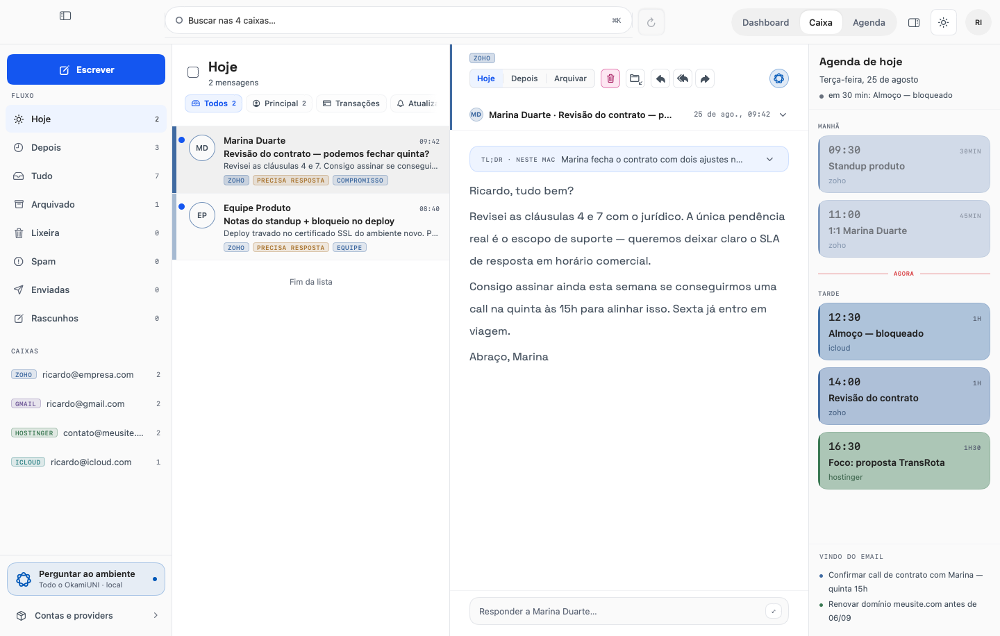

<div align="center">

# 🐺 OkamiUNI

**Native email and calendar, together on macOS.**

[Português (Brasil)](README.pt-BR.md) · **English**




</div>

OkamiUNI combines a unified inbox, calendar and daily planning dashboard in a native SwiftUI/AppKit application. Accounts and mail are stored locally, queued actions survive going offline, and AI features use the provider you choose. The interface follows the [original design and theme tokens](design/README.en.md), including 26 themes.

**[Download OkamiUNI for Mac](https://github.com/OkamiOps/okamiuni/releases/latest/download/OkamiUNI.dmg)** (macOS, signed and notarized). Open the `.dmg` and drag OkamiUNI onto Applications; after that it updates itself. See the [changelog](CHANGELOG.md), [all releases](https://github.com/OkamiOps/okamiuni/releases) and the [documentation index](docs/README.md).

## What the app does

| Area | Current behavior |
|---|---|
| Daily dashboard | Today's plan on a scrolling timeline, people waiting for a reply, appointments, money and deadlines, account filtering and an anchored activity bar. |
| Email | Unified inbox, provider folders, search, conversation stacks, swipe actions with Undo, keyboard shortcuts and custom context menus. |
| Reader | Sanitized HTML, readable text, collapsible quoted history/signatures, attachments on demand and confirmation showing the real destination before opening a link. Remote images are blocked until allowed; tracking pixels stay blocked even then. HTML sent without a `Content-Type`, with a tracker before the doctype or as a bare fragment is still rendered as HTML. |
| Sending | Gmail API or SMTP with TLS, account aliases from Gmail/Workspace, rich text, attachments, drafts and an offline queue with retry/error states. |
| Accounts | Google OAuth and IMAP/SMTP for providers accepting the implemented password authentication. Credentials live in Keychain; local data uses SQLite/GRDB. There is no hardcoded account limit. |
| Sync | IMAP IDLE, incremental Gmail history and network recovery; account reconnection preserves local account identity and data. |
| Calendar | Read/write access to macOS calendars through EventKit, including calendars configured in macOS; invitations and RSVP through the outgoing queue. |
| AI | Summaries, triage, suggested replies, writing tools and an assistant drawer (`⌘J`) or separate window. On-device Foundation Models and configured remote/CLI providers are supported. |
| Appearance | 26 themes, bundled fonts, resizable panes and native window controls. |

Connecting a remote or CLI AI provider intentionally enables automatic analysis and prepared replies through that provider. The AI settings switch restricts automatic work to this Mac. The interface identifies the destination; generated writing appears as a preview for acceptance. The interface language and AI response language are separate preferences.

The **Direct OAuth → Codex · ChatGPT account** connection uses the subscription directly over HTTP, with its own Keychain session. Login, the account’s model catalog and responses are independent of a CLI installation. **CLI · existing session** remains a separate connection; the subscription catalog has no embedded model list or fallback.

## Languages

The interface supports **Português (Brasil), English, Deutsch and Français**. Portuguese remains the default. In **Settings → General → App language**, choose a language or follow the system language. Quit and reopen the app to apply it to every window. If none of the system's preferred languages is supported, Portuguese is used.

Dates and numbers follow the selected interface language. Messages, provider folder names and other account content keep their original language. AI response preferences also include French. Account help is bundled for offline use in Portuguese and English; the English guides are used for English, German and French interfaces.

All maintained Markdown documentation is available in English and Portuguese. The [documentation index](docs/README.md) links each pair. Historical plans retain their dates and original code examples; screenshots and design prototypes may contain Portuguese sample content.

## Build and run

Requirements: **macOS 26**, **Xcode 26.6 / Swift 6.3** (the validated toolchain) and [XcodeGen](https://github.com/yonaskolb/XcodeGen). On-device AI additionally depends on Foundation Models availability on the Mac.

```bash
git clone https://github.com/OkamiOps/okamiuni.git
cd okamiuni
# Create the local configuration only if it does not already exist.
test -e Config/Google.xcconfig || cp Config/Google.example.xcconfig Config/Google.xcconfig
xcodegen generate
xcodebuild -project OkamiUNI.xcodeproj -scheme OkamiUNI \
  -configuration Debug -derivedDataPath build/DerivedData build
open build/DerivedData/Build/Products/Debug/OkamiUNI.app
```

The project specifies the maintainer's development signing team. For your own build, select your team and Apple Development certificate in Xcode, or supply your own `DEVELOPMENT_TEAM` to `xcodebuild`. Stable signing matters for Keychain access across builds. The generated `.xcodeproj` is not committed; persistent project changes belong in [`project.yml`](project.yml).

For Google accounts, configure the desktop OAuth client ID and, when supplied by Google, its client secret in the ignored `Config/Google.xcconfig`. Follow the [Google OAuth guide](docs/oauth-google.en.md). An empty configuration is valid: Google setup explains what is missing and the IMAP form remains available. See [app passwords and provider compatibility](docs/senha-de-app.en.md) before connecting an IMAP account.

For maintainers, `Tools/rodar.sh` rebuilds and opens the app. It also terminates the previous instance and clears saved window state, so use it deliberately.

## Architecture

Four Swift packages keep domain logic separate from views:

| Package | Responsibility |
|---|---|
| [`UNICore`](Packages/UNICore) | Models, pure logic, mail/conversation/calendar behavior and localization. |
| [`UNIDesign`](Packages/UNIDesign) | Theme tokens, typography and bundled fonts. |
| [`UNIShell`](Packages/UNIShell) | SwiftUI/AppKit screens, windows, controls and integration. |
| [`UNISync`](Packages/UNISync) | Accounts, Google OAuth/API, IMAP/SMTP, Keychain, database and outgoing queue. |

```text
App → UNIShell → UNIDesign
              → UNICore ← UNISync → Keychain · GRDB · Gmail API · IMAP · SMTP
```

Strict Swift concurrency checking is enabled. Civil calendar dates and minutes of the day are modeled explicitly; timestamps are converted at boundaries. The [engineering decision record](docs/decisoes-de-engenharia.en.md) documents the reasons and historical validation evidence.

## Validation and contribution

Tests use Swift Testing. Network tests use local servers or transport stubs; render tests host real SwiftUI/AppKit views offscreen without driving the user's keyboard or mouse.

```bash
python3 Tools/audit_localizations.py
swift test --package-path Packages/UNICore
swift test --package-path Packages/UNIDesign
swift test --package-path Packages/UNISync
swift test --package-path Packages/UNIShell
```

For focused localization verification and captures:

```bash
swift test --package-path Packages/UNICore --filter 'L10nTests|BundledTranslationTests'
UNI_RENDER_DIR=/tmp/okamiuni-localization \
  swift test --package-path Packages/UNIShell --filter LocalizationRenderTests
swift test --package-path Packages/UNIShell --filter AccountsDocsTests
```

Translations live in `Packages/UNICore/Sources/UNICore/Resources/*/Localizable.strings`. New interface strings use `L10n.tr("Texto \(valor)")`; catalog interpolation uses `{0}`, `{1}`, and so on. Keep all four catalogs aligned. Do not translate persisted identifiers, protocol values, account content or internal prompt identifiers. Update both documentation languages when behavior changes, and preserve historical source examples in plans.

The localization audit checks coverage, catalog parity and interpolation placeholders. Release-specific validation is recorded in the [v0.5.4 notes](docs/releases/v0.5.4.md); historical test totals are not a claim about a fresh full-suite run.

## Publishing a release

`Tools/publicar-release.sh X.Y.Z` builds a Developer ID–signed, notarized Release archive, generates the Sparkle 2 `appcast.xml`, and publishes the GitHub release plus the `gh-pages` appcast, in that order (the zip always lands before the appcast does). It requires a clean `main`, changelog sections for `X.Y.Z` in both languages, `docs/releases/vX.Y.Z.md`/`.pt-BR.md`, a "Developer ID Application" identity, a `notarytool` keychain profile named `okamiuni-notary`, and Sparkle's `sign_update` (override with `SPARKLE_BIN`).

```bash
Tools/publicar-release.sh 0.5.6 --dry-run   # build, sign, package and appcast, without publishing
Tools/publicar-release.sh 0.5.6              # the real thing: tag, GitHub release, gh-pages
```

`--dry-run` tolerates a missing Developer ID certificate, notary profile or `sign_update` binary — it skips exactly those steps and writes its output under `/tmp/okamiuni-release-dryrun`. `--instalar` replaces `/Applications/OkamiUNI.app` with the build just produced. `Tools/appcast.py` (the appcast generator) and its tests (`python3 -I -m unittest discover -s Tools -p 'test_*.py'`) can also be run on their own.

## Roadmap and limits

The native shell, account persistence, continuous sync, sending, EventKit calendar integration, AI assistant and daily planning dashboard are implemented. Version 0.5.4 adds four interface languages and bilingual documentation.

Upcoming work includes receivables and follow-ups derived from sent messages. Existing gaps include recurring-event workflows, direct CalDAV setup inside the app, fully indented provider-folder trees and forwarding an invitation with its `.ics`. CalDAV calendars already configured in macOS remain available through EventKit. Microsoft OAuth is not implemented; an app password does not make an OAuth-only provider compatible with the current IMAP route.

A visible control must perform its action or explain why it is unavailable. Changes to interactions should be verified through the real view/event path, and visual changes should be checked against [`design/tokens.json`](design/tokens.json) and the current [daily dashboard reference](design/11-painel-do-dia.dc.html).
